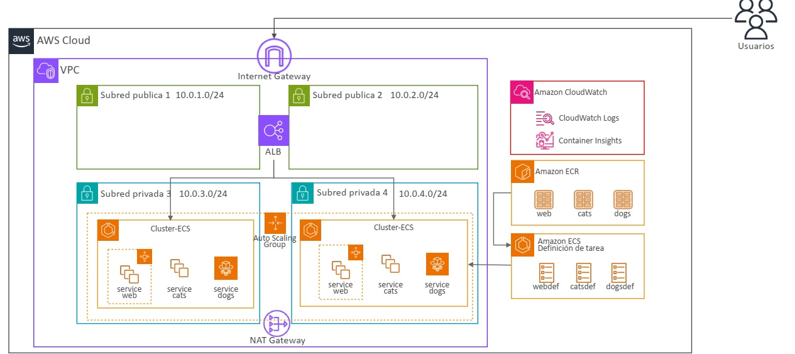
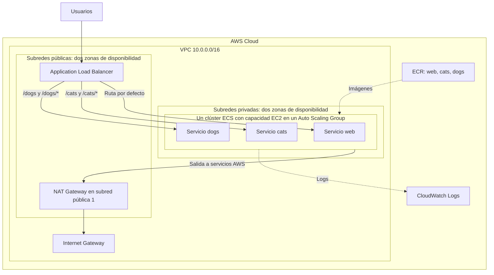

# Proyecto práctico real: Docker en AWS con Amazon ECS

Aplicación **Cats & Dogs** desplegada en contenedores Docker sobre Amazon ECS con instancias EC2, imágenes en Amazon ECR y un Application Load Balancer (ALB) que distribuye las peticiones según la URL.

> **Antes de empezar:** el desarrollo de este proyecto puede generar costes en AWS, aunque la aplicación reciba pocas visitas. El NAT Gateway, el balanceador, las instancias EC2, los discos EBS, las direcciones IPv4 públicas, ECR y CloudWatch pueden generar cargos. Consulta los precios de tu región, configura un presupuesto y elimina los recursos al terminar la práctica. No des por hecho que están cubiertos por la capa gratuita.

## Índice

- [Qué incluye el proyecto](#qué-incluye-el-proyecto)
- [Arquitectura](#arquitectura)
- [Requisitos](#requisitos)
- [1. Ejecutar en local](#1-ejecutar-en-local)
- [2. Preparar AWS](#2-preparar-aws)
- [3. Crear la red con CloudFormation](#3-crear-la-red-con-cloudformation)
- [4. Publicar las imágenes en ECR](#4-publicar-las-imágenes-en-ecr)
- [5. Preparar los roles IAM](#5-preparar-los-roles-iam)
- [6. Crear el clúster ECS sobre EC2](#6-crear-el-clúster-ecs-sobre-ec2)
- [7. Configurar el balanceador](#7-configurar-el-balanceador)
- [8. Crear las definiciones de tarea](#8-crear-las-definiciones-de-tarea)
- [9. Crear los servicios ECS](#9-crear-los-servicios-ecs)
- [10. Comprobar el despliegue](#10-comprobar-el-despliegue)
- [11. Escalado y observabilidad](#11-escalado-y-observabilidad)
- [12. Publicar una nueva versión](#12-publicar-una-nueva-versión)
- [Solución de problemas](#solución-de-problemas)
- [13. Eliminar los recursos](#13-eliminar-los-recursos)
- [Limitaciones y mejoras](#limitaciones-y-mejoras)

## Qué incluye el proyecto

Los tres servicios sirven HTML estático con Nginx. No hay una API, una base de datos ni comunicación interna entre los servicios: el navegador solicita cada página a través del mismo balanceador.

| Servicio | Carpeta | Ruta pública | Contenido |
| --- | --- | --- | --- |
| `web` | `Web/` | `/` | Página principal con enlaces a gatos y perros. |
| `cats` | `Cats/` | `/cats/` | Página de gatos. |
| `dogs` | `Dogs/` | `/dogs/` | Página de perros. |

```text
.
├── README.md
├── vpc.yaml                 # Red y grupos de seguridad de AWS
├── docs/
│   └── images/
│       └── arquitectura-ecs.jpg # Diagrama de arquitectura de referencia
├── Web/
│   ├── Dockerfile
│   ├── default.conf         # Configuración de Nginx
│   └── index.html
├── Cats/
│   ├── Dockerfile
│   ├── default.conf
│   └── index.html
└── Dogs/
    ├── Dockerfile
    ├── default.conf
    └── index.html
```

Cada Dockerfile parte de `public.ecr.aws/nginx/nginx:latest`, instala paquetes con APT, copia la configuración y el HTML y expone el puerto `80`. Los recursos visuales y algunas librerías del navegador se descargan desde sitios externos.

**Alcance de la automatización:** `vpc.yaml` crea la infraestructura de red. ECR, IAM, ECS, EC2, el Auto Scaling Group, el ALB y CloudWatch se configuran en los pasos siguientes. El repositorio no contiene una plantilla que despliegue toda la aplicación ni un archivo de Docker Compose.

## Arquitectura

Diagrama de arquitectura de referencia del proyecto:



El siguiente esquema complementa la imagen y representa el flujo de la arquitectura objetivo del laboratorio:



| Recurso de red | Rango o ubicación | Función |
| --- | --- | --- |
| VPC | `10.0.0.0/16` | Red del proyecto. |
| `PublicSubnet1` | `10.0.1.0/24`, zona A | ALB y NAT Gateway. |
| `PublicSubnet2` | `10.0.2.0/24`, zona B | ALB. |
| `PrivateSubnet1` | `10.0.3.0/24`, zona A | Instancias del clúster ECS. |
| `PrivateSubnet2` | `10.0.4.0/24`, zona B | Instancias del clúster ECS. |
| Internet Gateway | Asociado a la VPC | Salida de las subredes públicas. |
| NAT Gateway | `PublicSubnet1` | Salida de ambas subredes privadas. |

El ALB es el punto de entrada público. Las instancias EC2 permanecen en subredes privadas, sin IP pública. Las tablas de rutas públicas envían `0.0.0.0/0` al Internet Gateway y las privadas al NAT Gateway.

Hay **un único clúster ECS** con capacidad en dos zonas. Las dos cajas de ECS del diagrama de referencia representan su distribución entre zonas. El NAT Gateway reside en una subred pública, aunque en el diagrama aparezca cerca de las privadas.

La plantilla crea un solo NAT Gateway: la salida de ambas zonas depende de él y puede haber tráfico entre zonas. Esta configuración sirve para la práctica, pero no ofrece redundancia de salida. Consulta las [opciones de conectividad de ECS con servicios AWS](https://docs.aws.amazon.com/AmazonECS/latest/developerguide/networking-connecting-vpc.html).

## Requisitos

- Docker con el motor en ejecución y el comando `docker buildx` disponible.
- AWS CLI v2 y una cuenta de AWS con acceso a la consola.
- Una sesión o perfil con permisos para CloudFormation, VPC, EC2, Auto Scaling, ECR, ECS, ELB, CloudWatch e IAM, incluido `iam:PassRole` para los roles usados.
- Una terminal Bash o Zsh. Ejecuta los comandos desde la raíz del proyecto y conserva las variables en la misma sesión.
- Conexión a Internet para descargar imágenes, paquetes y recursos externos de las páginas.

Los ejemplos de AWS usan **Linux x86_64** y construyen imágenes `linux/amd64`, también si trabajas en un Mac con Apple Silicon.

## 1. Ejecutar en local

### Construir las tres imágenes

```bash
docker buildx build --platform linux/amd64 --load -t cats-dogs-web:v1 ./Web
docker buildx build --platform linux/amd64 --load -t cats-dogs-cats:v1 ./Cats
docker buildx build --platform linux/amd64 --load -t cats-dogs-dogs:v1 ./Dogs
```

### Arrancar los servicios

Para conservar las rutas de la aplicación, utiliza un cuarto contenedor Nginx como proxy local. Este contenedor sustituye al ALB únicamente durante la prueba local.

```bash
docker network create cats-dogs-local

docker run -d --name cats-dogs-web --network cats-dogs-local cats-dogs-web:v1
docker run -d --name cats-dogs-cats --network cats-dogs-local cats-dogs-cats:v1
docker run -d --name cats-dogs-dogs --network cats-dogs-local cats-dogs-dogs:v1

export LOCAL_PROXY_CONFIG="$(mktemp /tmp/cats-dogs-proxy.XXXXXX)"
cat > "$LOCAL_PROXY_CONFIG" <<'NGINX'
server {
    listen 80;
    location = /cats { proxy_pass http://cats-dogs-cats:80; }
    location /cats/ { proxy_pass http://cats-dogs-cats:80; }
    location = /dogs { proxy_pass http://cats-dogs-dogs:80; }
    location /dogs/ { proxy_pass http://cats-dogs-dogs:80; }
    location / { proxy_pass http://cats-dogs-web:80; }
}
NGINX

docker run -d --name cats-dogs-proxy \
  --network cats-dogs-local \
  -p 127.0.0.1:8080:80 \
  --mount "type=bind,source=$LOCAL_PROXY_CONFIG,target=/etc/nginx/conf.d/default.conf,readonly" \
  public.ecr.aws/nginx/nginx:latest
```

Abre [http://localhost:8080](http://localhost:8080) y pulsa en las imágenes. También puedes comprobar las respuestas:

```bash
curl -fsS http://localhost:8080/ | head
curl -fsS http://localhost:8080/cats/ | head
curl -fsS http://localhost:8080/dogs/ | head
docker logs cats-dogs-web
```

Las páginas deben mostrar los títulos `Gatos y Perros`, `Cats` y `Dogs`, respectivamente. En los Nginx de la aplicación, `try_files` devuelve `index.html` para rutas sin un archivo asociado, por lo que no hace falta eliminar los prefijos `/cats/` y `/dogs/`.

### Limpiar la prueba local

```bash
docker rm -f cats-dogs-proxy cats-dogs-web cats-dogs-cats cats-dogs-dogs
docker network rm cats-dogs-local
if [ -n "${LOCAL_PROXY_CONFIG:-}" ]; then
  rm -f "$LOCAL_PROXY_CONFIG"
  unset LOCAL_PROXY_CONFIG
fi
```

Las imágenes se conservan para publicarlas después en ECR.

## 2. Preparar AWS

Autentícate con tu perfil habitual. Por ejemplo, si tu organización utiliza IAM Identity Center:

```bash
aws configure sso --profile cats-dogs
export AWS_PROFILE=cats-dogs
aws sso login --profile "$AWS_PROFILE"
```

Si ya tienes una sesión configurada, utiliza su perfil. No guardes claves ni archivos de credenciales en el repositorio.

```bash
export AWS_REGION=eu-west-1
export STACK_NAME=cats-dogs-network
export CLUSTER_NAME=cats-dogs-cluster
export IMAGE_TAG=v1

aws sts get-caller-identity
export AWS_ACCOUNT_ID="$(aws sts get-caller-identity --query Account --output text)"
export ECR_REGISTRY="${AWS_ACCOUNT_ID}.dkr.ecr.${AWS_REGION}.amazonaws.com"
```

Comprueba la cuenta antes de crear recursos. En la consola, selecciona también `eu-west-1`.

**Regiones de la plantilla:** el mapa `DomainNameMappings` de `vpc.yaml` solo incluye `eu-west-1`, `eu-west-3`, `us-east-1`, `us-east-2`, `us-west-2`, `ap-northeast-1` y `ap-northeast-2`. Para otra región, adapta primero ese mapa. La plantilla utiliza las dos primeras zonas devueltas por `Fn::GetAZs`.

Consulta los [precios de red y NAT Gateway](https://aws.amazon.com/vpc/pricing/), [EC2](https://aws.amazon.com/ec2/pricing/), [ALB](https://aws.amazon.com/elasticloadbalancing/pricing/), [ECR](https://aws.amazon.com/ecr/pricing/) y [CloudWatch](https://aws.amazon.com/cloudwatch/pricing/). Puedes estimar el laboratorio con [AWS Pricing Calculator](https://calculator.aws/) y configurar avisos con [AWS Budgets](https://docs.aws.amazon.com/cost-management/latest/userguide/budgets-managing-costs.html). Un aviso de presupuesto no detiene por sí solo los recursos.

## 3. Crear la red con CloudFormation

La plantilla incluye VPC, cuatro subredes, rutas y asociaciones, Internet Gateway, NAT Gateway con Elastic IP, opciones DHCP y tres grupos de seguridad. **En este paso ya se crean recursos con coste.**

```bash
aws cloudformation validate-template \
  --template-body file://vpc.yaml \
  --region "$AWS_REGION"

aws cloudformation deploy \
  --template-file vpc.yaml \
  --stack-name "$STACK_NAME" \
  --region "$AWS_REGION" \
  --no-fail-on-empty-changeset

aws cloudformation describe-stacks \
  --stack-name "$STACK_NAME" \
  --region "$AWS_REGION" \
  --query 'Stacks[0].Outputs' \
  --output table
```

Anota los identificadores de la VPC y de las cuatro subredes. En **CloudFormation → Recursos** encontrarás también los identificadores físicos de estos grupos:

| Identificador lógico | Regla de entrada de la plantilla | Uso en la práctica |
| --- | --- | --- |
| `ALBSG` | TCP `80` desde `0.0.0.0/0`. | Asociar al ALB. |
| `ECSInstanceSG` | TCP `0–65535` desde `ALBSG`. | Asociar a las instancias EC2; permite puertos dinámicos. |
| `WorkstationSG` | TCP `22` desde `0.0.0.0/0`. | No es necesario para esta guía; las imágenes se publican desde tu equipo. |

No asocies `WorkstationSG` a las instancias del clúster. Si decides utilizar una máquina de trabajo adicional, restringe su acceso SSH a tu IP antes de asociarlo. La plantilla crea el grupo, pero no crea esa máquina.

## 4. Publicar las imágenes en ECR

Crea tres repositorios privados. Los comandos de creación se ejecutan una sola vez; si ya existen, continúa con la autenticación.

```bash
for service in web cats dogs; do
  aws ecr create-repository \
    --repository-name "$service" \
    --image-scanning-configuration scanOnPush=true \
    --region "$AWS_REGION"
done

aws ecr get-login-password --region "$AWS_REGION" \
  | docker login --username AWS --password-stdin "$ECR_REGISTRY"

for service in web cats dogs; do
  docker tag "cats-dogs-${service}:${IMAGE_TAG}" "${ECR_REGISTRY}/${service}:${IMAGE_TAG}"
  docker push "${ECR_REGISTRY}/${service}:${IMAGE_TAG}"
done
```

Comprueba en ECR que cada repositorio contiene la etiqueta `v1`. Las imágenes que usarán las tareas tienen este formato:

```text
<AWS_ACCOUNT_ID>.dkr.ecr.eu-west-1.amazonaws.com/web:v1
<AWS_ACCOUNT_ID>.dkr.ecr.eu-west-1.amazonaws.com/cats:v1
<AWS_ACCOUNT_ID>.dkr.ecr.eu-west-1.amazonaws.com/dogs:v1
```

La autenticación del registro caduca: si una publicación posterior falla por credenciales vencidas, repite `get-login-password`. Referencia: [publicar imágenes en ECR](https://docs.aws.amazon.com/AmazonECR/latest/userguide/docker-push-ecr-image.html).

## 5. Preparar los roles IAM

En **IAM → Roles**, crea o reutiliza estos roles:

| Rol de ejemplo | Entidad de confianza | Permisos y asociación |
| --- | --- | --- |
| `cats-dogs-ecs-instance-role` | Servicio `ec2.amazonaws.com`. | Política administrada `AmazonEC2ContainerServiceforEC2Role`. Asociarlo mediante un perfil de instancia a las EC2 del clúster. |
| `cats-dogs-task-execution-role` | Servicio `ecs-tasks.amazonaws.com`. | Política administrada `AmazonECSTaskExecutionRolePolicy`. Seleccionarlo como **Task execution role** en las tres definiciones de tarea. |

El rol de instancia permite registrar las EC2 y operar el agente ECS. El rol de ejecución aporta los permisos de extracción de imágenes y envío de logs utilizados por el agente según su configuración. Las páginas no necesitan un **Task role** propio porque no llaman a APIs de AWS.

La cuenta también necesita el rol vinculado al servicio `AWSServiceRoleForECS`; ECS puede crearlo automáticamente si tu identidad tiene permiso. Consulta el [rol de instancia ECS](https://docs.aws.amazon.com/AmazonECS/latest/developerguide/instance_IAM_role.html) y el [rol de ejecución de tareas](https://docs.aws.amazon.com/AmazonECS/latest/developerguide/task_execution_IAM_role.html).

## 6. Crear el clúster ECS sobre EC2

En **Amazon ECS → Clústeres**, crea `cats-dogs-cluster` con capacidad **EC2** mediante un Auto Scaling Group. Esta guía utiliza EC2 para reproducir el esquema del proyecto.

Configura la capacidad con estos valores de laboratorio:

| Opción | Valor |
| --- | --- |
| AMI | Amazon Linux 2023 optimizada para ECS, Linux x86_64. |
| Tipo de instancia | Por ejemplo, `t3.small`; comprueba disponibilidad, capacidad y precio en tu región. |
| VPC | La creada por `vpc.yaml`. |
| Subredes de las EC2 | `PrivateSubnet1` y `PrivateSubnet2`. |
| IP pública | Desactivada. |
| Grupo de seguridad | `ECSInstanceSG` de la plantilla. |
| Perfil de instancia | El del rol `cats-dogs-ecs-instance-role`. |
| Auto Scaling Group | Mínimo `2`, deseado inicial `2`, máximo `4`. |
| Capacity provider | Asociado al ASG, con escalado administrado y `targetCapacity=100`. |

Si la consola no permite ajustar algún valor al crear el clúster, modifica la plantilla de lanzamiento y el ASG correspondiente antes de desplegar las tareas. Al cambiar los datos de usuario, usa una nueva versión de la plantilla de lanzamiento y renueva las instancias existentes.

Para una plantilla de lanzamiento configurada manualmente, estos datos de usuario registran las instancias en el clúster y habilitan el uso del rol de ejecución para `awslogs`:

```bash
#!/bin/bash
cat >> /etc/ecs/ecs.config <<'ECSCONFIG'
ECS_CLUSTER=cats-dogs-cluster
ECS_AVAILABLE_LOGGING_DRIVERS=["json-file","awslogs"]
ECS_ENABLE_AWSLOGS_EXECUTIONROLE_OVERRIDE=true
ECSCONFIG
```

Si cambias el nombre del clúster, cambia también `ECS_CLUSTER`. Con una AMI optimizada para ECS no necesitas instalar Docker ni el agente manualmente.

Antes de seguir, comprueba que ECS muestra las instancias registradas y activas, idealmente una por zona. Si no aparecen, revisa el perfil IAM, los datos de usuario y la ruta privada hacia el NAT. Referencia: [crear un clúster ECS para EC2](https://docs.aws.amazon.com/AmazonECS/latest/developerguide/create-ec2-cluster-console-v2.html).

## 7. Configurar el balanceador

En **EC2 → Grupos de destino**, crea tres target groups dentro de la VPC del proyecto:

| Nombre | Tipo de destino | Protocolo y puerto inicial | Health check |
| --- | --- | --- | --- |
| `cats-dogs-web-tg` | `Instances` | HTTP `80` | HTTP, puerto de tráfico, ruta `/`, código `200`. |
| `cats-dogs-cats-tg` | `Instances` | HTTP `80` | HTTP, puerto de tráfico, ruta `/`, código `200`. |
| `cats-dogs-dogs-tg` | `Instances` | HTTP `80` | HTTP, puerto de tráfico, ruta `/`, código `200`. |

No registres destinos manualmente: ECS registrará las combinaciones de instancia y puerto dinámico de cada tarea.

En **EC2 → Balanceadores de carga**, crea un **Application Load Balancer**:

1. Nombre: `cats-dogs-alb`.
2. Esquema: público, **Internet-facing**, IPv4.
3. VPC: la del proyecto; subredes: `PublicSubnet1` y `PublicSubnet2`.
4. Grupo de seguridad: `ALBSG`.
5. Listener: HTTP `80`, con acción por defecto de reenvío a `cats-dogs-web-tg`.

Añade estas reglas al listener:

| Prioridad | Condición de ruta | Acción |
| --- | --- | --- |
| `10` | `/cats` y `/cats/*` | Reenviar a `cats-dogs-cats-tg`. |
| `20` | `/dogs` y `/dogs/*` | Reenviar a `cats-dogs-dogs-tg`. |
| Por defecto | Resto de rutas. | Reenviar a `cats-dogs-web-tg`. |

Los dos patrones de cada regla cubren la ruta con y sin barra final. El ALB conserva el prefijo de la URL; la configuración `try_files` incluida permite servir el HTML correspondiente.

Usaremos tareas con red **`bridge`** y `hostPort: 0`, por lo que los destinos son de tipo **`Instances`**. Si adaptas el despliegue a `awsvpc`, deberás usar destinos de tipo `ip` y revisar la configuración de red. Referencia: [balanceo de carga en ECS](https://docs.aws.amazon.com/AmazonECS/latest/developerguide/service-load-balancing.html).

## 8. Crear las definiciones de tarea

Primero crea los grupos de logs y establece una retención de siete días. Si ya existen, ejecuta únicamente la actualización de retención.

```bash
for service in web cats dogs; do
  aws logs create-log-group \
    --log-group-name "/ecs/cats-dogs/$service" \
    --region "$AWS_REGION"
  aws logs put-retention-policy \
    --log-group-name "/ecs/cats-dogs/$service" \
    --retention-in-days 7 \
    --region "$AWS_REGION"
done
```

En **ECS → Definiciones de tarea**, crea tres definiciones compatibles con **EC2**, con los siguientes valores:

| Familia | Contenedor | Imagen | Puerto del contenedor | Puerto del host | Grupo de logs |
| --- | --- | --- | --- | --- | --- |
| `webdef` | `web` | `${ECR_REGISTRY}/web:v1` | `80` | `0` | `/ecs/cats-dogs/web` |
| `catsdef` | `cats` | `${ECR_REGISTRY}/cats:v1` | `80` | `0` | `/ecs/cats-dogs/cats` |
| `dogsdef` | `dogs` | `${ECR_REGISTRY}/dogs:v1` | `80` | `0` | `/ecs/cats-dogs/dogs` |

Sustituye `${ECR_REGISTRY}` por el valor real: **la consola y los archivos JSON no expanden variables de la terminal**.

Configura el modo de red `bridge`, el sistema operativo Linux y la arquitectura x86_64. Asigna `256` unidades de CPU y una reserva de memoria de `128 MiB` al contenedor como punto de partida para estas páginas estáticas. Usa el rol de ejecución del paso 5 y el driver de logs `awslogs`, con la región del despliegue y el prefijo `ecs`.

Este es un ejemplo JSON para `webdef`. Sustituye `123456789012` por tu cuenta y ajusta la región si procede antes de usarlo en la consola o guardarlo para registrarlo con AWS CLI:

```json
{
  "family": "webdef",
  "requiresCompatibilities": ["EC2"],
  "networkMode": "bridge",
  "runtimePlatform": {
    "cpuArchitecture": "X86_64",
    "operatingSystemFamily": "LINUX"
  },
  "executionRoleArn": "arn:aws:iam::123456789012:role/cats-dogs-task-execution-role",
  "containerDefinitions": [
    {
      "name": "web",
      "image": "123456789012.dkr.ecr.eu-west-1.amazonaws.com/web:v1",
      "essential": true,
      "cpu": 256,
      "memoryReservation": 128,
      "portMappings": [
        { "containerPort": 80, "hostPort": 0, "protocol": "tcp" }
      ],
      "logConfiguration": {
        "logDriver": "awslogs",
        "options": {
          "awslogs-group": "/ecs/cats-dogs/web",
          "awslogs-region": "eu-west-1",
          "awslogs-stream-prefix": "ecs"
        }
      }
    }
  ]
}
```

Repite para `catsdef` y `dogsdef`, cambiando familia, nombre del contenedor, imagen y grupo de logs. El puerto del host `0` permite ejecutar varias tareas del mismo servicio en una EC2 sin colisiones. Los permisos y la configuración del agente deben permitir [enviar logs a CloudWatch](https://docs.aws.amazon.com/AmazonECS/latest/developerguide/using_awslogs.html).

## 9. Crear los servicios ECS

Dentro de `cats-dogs-cluster`, crea tres servicios de tipo **REPLICA**:

| Servicio | Definición de tarea | Tareas deseadas | Target group | Contenedor y puerto |
| --- | --- | --- | --- | --- |
| `web` | Última revisión de `webdef`. | `2` | `cats-dogs-web-tg` | `web:80` |
| `cats` | Última revisión de `catsdef`. | `2` | `cats-dogs-cats-tg` | `cats:80` |
| `dogs` | Última revisión de `dogsdef`. | `2` | `cats-dogs-dogs-tg` | `dogs:80` |

Para cada servicio:

1. Selecciona la estrategia de **capacity provider** del ASG creado en el paso 6, con peso `1`.
2. Configura la distribución de tareas con `spread` por `attribute:ecs.availability-zone` y después por `instanceId`.
3. Asocia el ALB existente, el target group del servicio y el puerto `80` de su contenedor.
4. Usa un periodo de gracia para health checks de `60` segundos como valor inicial.
5. Comprueba que el despliegue mantiene capacidad para iniciar tareas nuevas antes de detener las anteriores.

Con red `bridge`, las tareas usan la red de las instancias: las subredes y el grupo de seguridad se eligen en la capacidad EC2, no como una configuración `awsvpc` del servicio. No habilites IP pública para las tareas.

ECS registrará automáticamente los puertos de host asignados en cada target group. Espera a que las seis tareas estén en `RUNNING` y los destinos en estado `healthy`.

## 10. Comprobar el despliegue

```bash
aws ecs wait services-stable \
  --cluster "$CLUSTER_NAME" \
  --services web cats dogs \
  --region "$AWS_REGION"

aws ecs describe-services \
  --cluster "$CLUSTER_NAME" \
  --services web cats dogs \
  --region "$AWS_REGION" \
  --query 'services[].{Servicio:serviceName,Deseadas:desiredCount,Activas:runningCount,Pendientes:pendingCount}' \
  --output table

export ALB_DNS="$(aws elbv2 describe-load-balancers \
  --names cats-dogs-alb \
  --region "$AWS_REGION" \
  --query 'LoadBalancers[0].DNSName' \
  --output text)"

curl -fsS "http://${ALB_DNS}/" | head
curl -fsS "http://${ALB_DNS}/cats/" | head
curl -fsS "http://${ALB_DNS}/dogs/" | head
```

Abre `http://<DNS_DEL_ALB>` en el navegador. Comprueba que los enlaces funcionan, cada ruta devuelve su página y los logs registran las peticiones. Verifica el contenido, además del código HTTP: como Nginx tiene un fallback a `index.html`, una regla incorrecta puede devolver `200` con la página de otro servicio.

## 11. Escalado y observabilidad

Hay dos niveles de escalado distintos:

- **Service Auto Scaling:** cambia el número de tareas de un servicio. Para practicar, configura en `web` un mínimo de `2`, máximo de `4` y seguimiento de objetivo sobre `ECSServiceAverageCPUUtilization` al `60 %`.
- **Escalado del clúster:** el capacity provider ajusta el número de EC2 del ASG cuando hace falta capacidad. Respeta los límites del ASG; no aumentará por encima del máximo configurado.

Mantén la política de capacidad administrada por ECS y evita añadir otra política que compita por el tamaño del mismo ASG. Referencia: [escalado automático del clúster ECS](https://docs.aws.amazon.com/AmazonECS/latest/developerguide/cluster-auto-scaling.html).

En CloudWatch Logs, consulta `/ecs/cats-dogs/web`, `/ecs/cats-dogs/cats` y `/ecs/cats-dogs/dogs`:

```bash
aws logs tail /ecs/cats-dogs/web --since 10m --follow --region "$AWS_REGION"
```

Revisa también los eventos de los servicios ECS, las tareas detenidas y los health checks de los target groups. Puedes habilitar **Container Insights** para añadir observabilidad del clúster; en EC2, revisa también los requisitos del agente de CloudWatch y sus permisos. No queda habilitado por `vpc.yaml` y puede generar cargos adicionales. Consulta la [configuración de Container Insights para ECS](https://docs.aws.amazon.com/AmazonCloudWatch/latest/monitoring/deploy-container-insights-ECS.html).

## 12. Publicar una nueva versión

Ejemplo para actualizar únicamente `web`:

```bash
export IMAGE_TAG=v2

docker buildx build --platform linux/amd64 --load \
  -t "cats-dogs-web:${IMAGE_TAG}" ./Web
docker tag "cats-dogs-web:${IMAGE_TAG}" "${ECR_REGISTRY}/web:${IMAGE_TAG}"
docker push "${ECR_REGISTRY}/web:${IMAGE_TAG}"
```

Después, crea una nueva revisión de `webdef` con la imagen `web:v2` y actualiza el servicio `web` para utilizar esa revisión. Espera a que se estabilice y comprueba la página y los logs. Para volver atrás, actualiza el servicio a la revisión anterior, conservando su imagen en ECR.

Publicar una imagen por sí solo no actualiza las tareas existentes. Utiliza etiquetas de versión diferentes para identificar qué se ha desplegado.

## Solución de problemas

| Síntoma | Qué revisar |
| --- | --- |
| Falla `apt-get install awscli` o la construcción de la imagen. | Los Dockerfile usan `latest` y dependen de los paquetes disponibles en la imagen base. Revisa la salida de APT; fija una base compatible y adapta la instalación si ha cambiado. AWS CLI dentro del contenedor no es necesaria para servir HTML ni para publicar desde tu equipo. |
| `exec format error`. | La arquitectura de la imagen y de la EC2 debe coincidir. Esta guía utiliza `linux/amd64` con EC2 x86_64. |
| La EC2 no aparece en el clúster. | AMI optimizada para ECS, `ECS_CLUSTER`, perfil de instancia, DNS y salida por NAT. |
| Tareas en `PENDING` o `PROVISIONING`. | Capacidad de CPU/memoria, instancias registradas, límites y estrategia del capacity provider y máximo del ASG. |
| `CannotPullContainerError`. | URI y etiqueta de ECR, región, permisos de extracción y conectividad desde las subredes privadas. |
| El ALB devuelve `503`. | Servicios con tareas activas y destinos registrados y saludables en el target group correcto. |
| El ALB devuelve `502` o el health check falla. | Nginx escuchando en `80`, mapeo dinámico, puerto de tráfico del health check y entrada desde `ALBSG` a `ECSInstanceSG`. |
| `/cats/` o `/dogs/` muestra la portada. | Prioridades, condiciones y target groups de las reglas del listener. |
| Error al inicializar `awslogs`. | Grupo de logs existente, región, rol de ejecución, permisos y `ECS_ENABLE_AWSLOGS_EXECUTIONROLE_OVERRIDE=true` en las EC2. |
| El HTML funciona, pero faltan imágenes o estilos. | Recursos externos bloqueados, eliminados o sin conectividad desde el navegador. |
| CloudFormation falla al buscar un dominio DHCP. | La región debe estar en `DomainNameMappings`. |
| CloudFormation no puede eliminar la VPC. | Quedan recursos externos a la pila: ALB, EC2, interfaces de red o grupos de seguridad asociados. |

## 13. Eliminar los recursos

**Esta sección elimina el laboratorio y sus datos.** Verifica la cuenta, la región y los nombres; conserva únicamente los recursos que necesites reutilizar. Detener tareas o borrar el clúster no elimina automáticamente el NAT, el ALB, ECR ni los logs.

1. Elimina las políticas de Service Auto Scaling y establece el número deseado de tareas de `web`, `cats` y `dogs` en `0`. Espera a que se detengan y elimina los tres servicios.
2. Desactiva el escalado administrado del capacity provider para que no reponga capacidad durante la limpieza. Pon el mínimo y el deseado del ASG en `0`; si hay protección contra reducción de capacidad, retírala de las instancias. Espera a que terminen y elimina el ASG y su plantilla de lanzamiento si son exclusivos del laboratorio.
3. Retira el capacity provider de las estrategias del clúster, desasócialo, elimínalo y elimina el clúster ECS. Si la consola creó una pila adicional para su capacidad, revisa y elimina esa pila también.
4. Elimina `cats-dogs-alb` y después sus tres target groups. Espera a que se liberen las interfaces de red.
5. Elimina los repositorios ECR y los grupos de logs del proyecto si ya no quieres conservarlos. Los comandos siguientes borran también las imágenes y el historial de logs:

```bash
for service in web cats dogs; do
  aws ecr delete-repository \
    --repository-name "$service" \
    --force \
    --region "$AWS_REGION"
  aws logs delete-log-group \
    --log-group-name "/ecs/cats-dogs/$service" \
    --region "$AWS_REGION"
done
```

6. Elimina cualquier recurso adicional creado para la práctica, como agentes de observabilidad, alarmas, grupos de seguridad o endpoints. Con la VPC libre de dependencias, elimina la pila de red:

```bash
aws cloudformation delete-stack \
  --stack-name "$STACK_NAME" \
  --region "$AWS_REGION"

aws cloudformation wait stack-delete-complete \
  --stack-name "$STACK_NAME" \
  --region "$AWS_REGION"
```

7. Comprueba que se han eliminado el NAT Gateway, su Elastic IP y las instancias y volúmenes del laboratorio. Elimina los roles y perfiles IAM exclusivos del proyecto cuando ya no tengan asociaciones; conserva los roles compartidos.
8. Revisa la consola de facturación posteriormente: los datos de consumo pueden tardar en reflejarse.

## Limitaciones y mejoras

- **Reproducibilidad:** fijar versiones o digests de las imágenes base; revisar las actualizaciones e instalaciones de APT. Los patrones `rm -rf /tmp/_` y `/var/lib/apt/lists/_` de los Dockerfile actuales no limpian todo el contenido de esos directorios.
- **Imágenes más pequeñas:** retirar AWS CLI y otros paquetes que no se necesitan para servir las páginas, si el objetivo de la práctica no requiere usarlos dentro del contenedor.
- **HTTPS:** añadir un dominio, un certificado de ACM, listener `443`, su regla de seguridad y redirección desde HTTP antes de ofrecer el sitio como servicio público habitual.
- **Disponibilidad de salida:** valorar un NAT Gateway por zona con tablas de rutas privadas separadas, o endpoints VPC adecuados para los servicios utilizados, teniendo en cuenta sus costes.
- **Infraestructura como código:** automatizar los recursos que ahora se crean desde la consola y añadir un flujo de construcción y despliegue.
- **Recursos estáticos:** alojar imágenes y librerías con versiones controladas para reducir la dependencia de enlaces externos y revisar sus condiciones de uso antes de redistribuirlos.
- **Licencia:** el repositorio no incluye un archivo `LICENSE`; añade la licencia que decidas utilizar antes de distribuir el código con permisos explícitos de reutilización.

Esta guía documenta los archivos del repositorio y propone un procedimiento de despliegue. La existencia del README no implica que los recursos ya estén creados ni que el despliegue haya sido validado en una cuenta AWS.
